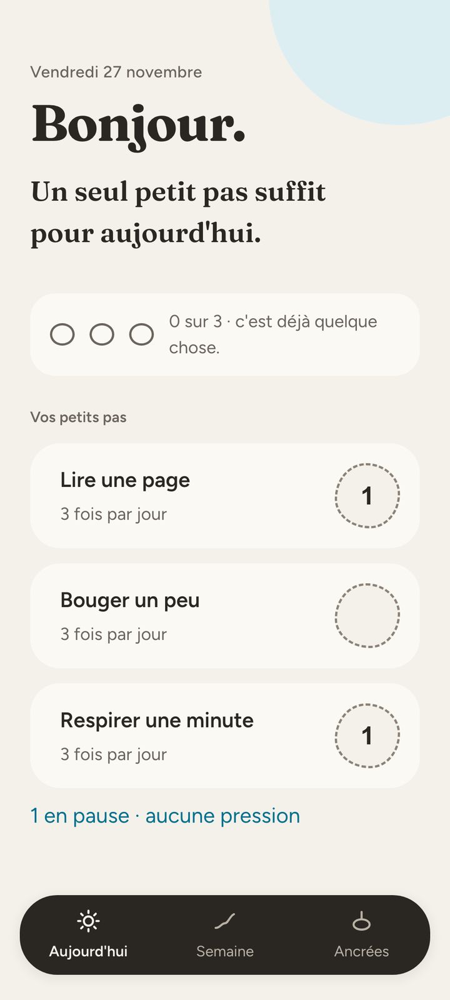
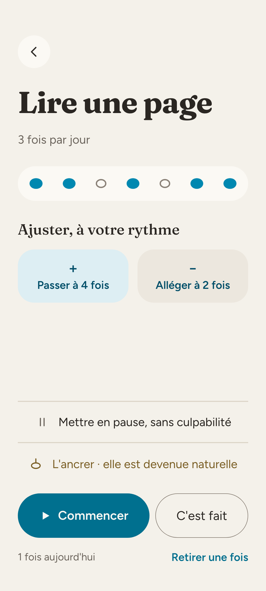
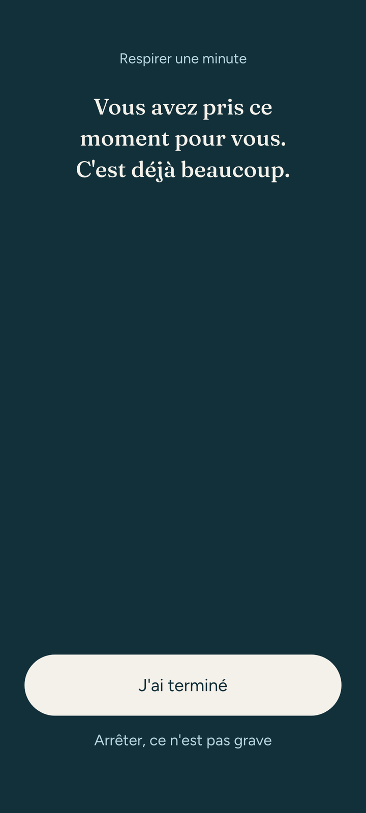
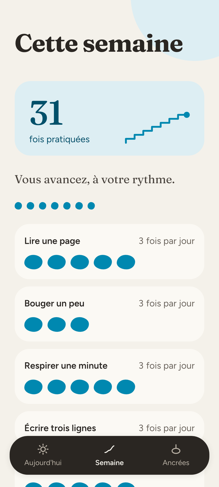
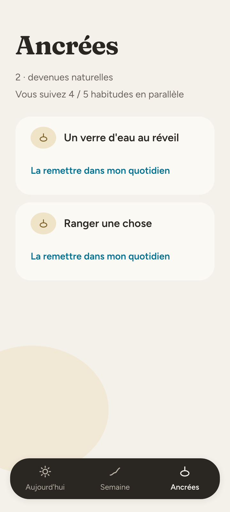
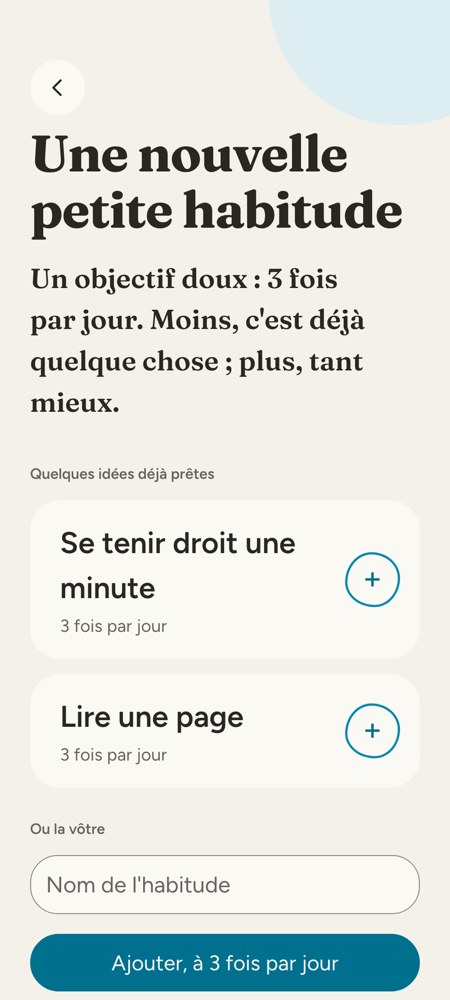

# 6 · Système de design — Galets

> **Remplace [`05-style-graphique.md`](05-style-graphique.md) (« Broadsheet »)** depuis
> l'issue #55 (2026-09). Les deux règles d'accent tranchées sous Broadsheet (#30, #32), les
> icônes, la règle de focus et les animations sont reprises ici : ce fichier suffit pour
> habiller un nouvel écran. Il dit **les règles** ; la section « Écarts actuels » dit où le
> code ne les suit pas encore.

Le design **Galets** : un papier sable chaud, un titrage en **Fraunces** sur un texte courant
en **Figtree**, et des **formes de galet** — légèrement irrégulières — pour tout ce que le
pouce touche. Le cyan d'imprimerie reste l'accent, en petites touches délibérées. Le rituel
passe en **fond sombre**, pour se distinguer du reste de l'app comme un moment à part.

Les classes CSS de `app/assets/main.css` sont le système de composants (voir « Composants
Dioxus »). Ne jamais coder un hex, un rayon ou une marge en dur : passer par `var(--…)`.

## Couleurs

Toutes les couleurs sont des variables `var(--color-*)` dans `:root`.

| Rôle | Variable | Hex | Usage |
| --- | --- | --- | --- |
| Papier | `--color-paper` | `#F4F1EA` | fond des écrans |
| Carte | `--color-card` | `#FBF9F4` | surfaces posées sur le papier ; texte sur aplat d'accent (`--color-on-accent`) |
| Encre | `--color-ink` | `#2A2622` | texte ; fond de la barre du bas |
| Encre douce | `--color-ink-soft` | `#6B645C` | texte secondaire (eyebrows, notes, méta) |
| Encre moyenne | `--color-ink-mid` | `#4A443E` | texte de lecture entre l'encre et l'encre douce (mot de la semaine) |
| Encre douce sur encre | `--color-on-ink-soft` | `#B9B1A5` | texte et éléments **sur fond encre** : onglets inactifs de la barre du bas |
| Filet | `--color-rule` | `#DCD5C8` | séparateurs décoratifs uniquement (jamais le seul indice d'un contrôle) |
| Contour | `--color-outline` | `#8A8177` | contours de contrôle (`.target`, `.input`, `.btn-secondary`) et états éteints (`.rhythm-dot`, `.day-pebble`) |
| Tuile neutre | `--color-tile-neutral` | `#ECE7DE` | tuile « alléger » : le geste doux, ni pratique ni accent |
| Accent | `--color-accent` | `#0088b0` | aplats : l'interactif, le fait d'avoir pratiqué |
| Accent texte | `--color-accent-text` | `#00708F` | texte en accent, boutons qui portent du texte |
| Accent survol | `--color-accent-hover` | `#005A73` | état survolé / pressé |
| Teinte | `--color-tint` / `--color-on-tint` | `#DDEEF3` / `#00506A` | fonds teintés et leur texte |
| Ancrée | `--color-anchored` / `--color-anchored-tint` | `#7A5E24` / `#EFE3C8` | habitudes acquises (ocre) |
| Ombre | `--color-shadow` | `42, 38, 34` | triplet RGB de l'encre pour `--shadow-*` |

**Rituel (scopé par `.screen.ritual`)** : `--color-ritual-ground` `#12303A` (fond),
`--color-ritual-ink` `#F4F1EA` (texte), `--color-ritual-ink-soft` `#B8D6DF` (texte doux et
survol). Le fond sombre s'étend à `html` et
`body` via `:has(.screen.ritual)`, pour qu'aucune bande claire n'apparaisse au défilement.

**Règle — pourquoi deux cyans :** `#0088b0` n'atteint que **3,6:1** sur le papier. Il reste
l'accent des aplats (cibles, barres, points), où 3:1 suffit à un élément graphique ; tout
texte en accent prend `#00708F` (**5,0:1**), qui passe AA.

**Règle — l'accent ne dit qu'une chose (issue #30, reprise de Broadsheet) :** en dehors de
l'interactif, le cyan signifie **« pratiqué »**, et rien d'autre. Avant de peindre en accent :
*est-ce que cet élément affirme que l'utilisateur a pratiqué ?* — non ⇒ tonalité neutre.

**Règle — la couleur ne porte jamais un signal toute seule (issue #32, reprise de
Broadsheet) :** tout signal chromatique se double d'un indice de forme — présence ou absence
d'un élément, jamais deux nuances du même. Le contraste qui compte est celui de l'état
allumé contre l'état éteint, pas celui de chacun contre le papier. La cible « fait » garde
son tampon (coche, `::before`/`::after`) en plus de sa couleur.

### Contrastes mesurés

| Paire | Ratio |
| --- | --- |
| Encre / papier | 13,3:1 |
| Encre douce / papier | 5,2:1 |
| Accent texte / papier | 5,0:1 |
| Carte sur accent texte (bouton) | 5,4:1 |
| Texte sur teinte | 7,5:1 |
| Ocre sur teinte ocre | 4,8:1 |
| Texte rituel / fond rituel | 12,3:1 (doux : 9,1:1) |
| Anneau de focus (accent) / papier · encre · rituel | 3,62 · 3,68 · 3,41:1 |
| Contour de contrôle `#8A8177` / papier · carte · teinte | 3,39 · 3,64 · 3,21:1 |
| Filet `#DCD5C8` / papier · carte | 1,29 · 1,39:1 — décoratif, jamais un contour de contrôle |
| Placeholder (encre douce `#6B645C`) / carte (`.input`) | 5,54:1 |

## Typographie

- **Fraunces** (`--font-display`) pour les titres : salutation, grands chiffres du récap,
  titre de la semaine, parole douce du rituel.
- **Figtree** (`--font-body`) pour tout le reste : texte courant, boutons, champs.
- Les deux polices sont **embarquées** (`app/assets/fonts/`, variables, licence OFL) et
  préchargées par `app/src/main.rs` — l'app n'appelle plus Google Fonts et s'affiche
  identique hors ligne, Android compris. La liste `BUNDLED_FONTS` y est la source unique :
  un test vérifie que chaque `@font-face` de `main.css` désigne une police de cette liste.
- L'italique garde son rôle émotionnel (encouragements, synthèses).

### Échelle

| Rôle | Classe / balise | Police · taille · graisse | Couleur |
| --- | --- | --- | --- |
| Titre d'écran (un par écran) | `h1.greeting` | Fraunces · `clamp(30px, 8.2vw, 56px)` · 700 | encre |
| Chapeau | `.lede` | Fraunces · `clamp(18px, 4.8vw, 22px)` · 600 | encre |
| Titre de section | `h2.pace-heading` | Fraunces · 20px · 500 | encre |
| Eyebrow (étiquette de section) | `.eyebrow` | Figtree · 12px · 600 | encre douce |
| Texte courant, nom d'habitude, bouton | `body`, `.habit-name`, `.btn` | Figtree · 17px | encre |
| Note discrète | `.quiet-note` | Figtree · 14px | encre douce |
| Date du masthead | `.masthead-date` | Figtree · 13px · 500 | encre douce |

Une eyebrow ouvre une section : beaucoup de blanc au-dessus, peu en dessous. Elle **nomme**
la section, comme le ferait un `h2` : si elle titre du contenu, elle prend la même balise
(voir « Accessibilité »).

## Formes et espacements

| Variable | Valeur | Usage |
| --- | --- | --- |
| `--radius-pebble` | `48% 52% 46% 54% / 55% 47% 53% 45%` | cible, points de rythme, ajout |
| `--radius-pill` | `30px` | boutons, barre du bas |
| `--radius-field` | `22px` | champs de saisie, tuiles « ajuster » |
| `--radius-card` | `20px` | carte récap d'Aujourd'hui |
| `--radius-habit` | `24px` | ligne d'habitude, cartes de la semaine |
| `--radius-tint` | `26px` | grande carte teintée de la semaine |
| `--radius-bar` | `4px` | sommet des barres de courbe |
| `--space-1…7` | 4 · 8 · 12 · 16 · 24 · 32 · 48 px | toute marge, tout écart ; pas de valeur hors échelle |
| `--screen-max-width` | `620px` | largeur du contenu, centré au-delà |
| `--bottom-nav-height` / `--bottom-nav-offset` | `64px` / `20px` | barre du bas et son décalage ; le contenu les dégage |
| `--action-dock-height` | `60px` | hauteur du bouton d'action fixé en bas (Détail, Rituel) |
| `--lifecycle-gesture-height` | `56px` | hauteur d'une ligne de geste de fin de vie (Détail) |

Les hauteurs fixes (`--bottom-nav-height`, `--action-dock-height`,
`--lifecycle-gesture-height`) servent à réserver la place des éléments en `position: fixed` :
un écran qui en porte réserve leur somme en bas. Les ombres restent douces (`--shadow-sm` /
`--shadow-md`), dérivées de l'encre. Les marges de sécurité (`--safe-area-inset-*`) s'ajoutent
à tout élément collé à un bord.

## Composants

Les classes CSS sont le système de composants. Chaque composant a le même vocabulaire d'états :

| Composant | Défaut | Survol | Pressé | Focus clavier | Fait | Désactivé |
| --- | --- | --- | --- | --- | --- | --- |
| Cible `.target` (galet 52px) | galet pointillé, fond papier | bordure accent | `scale(.94)` | anneau accent | `.is-done` : bordure pleine, aplat accent, coche, anneau `kzRing` ; avec essais partiels, le compte du jour | — |
| Bouton `.btn` (pilule) | contour encre, fond transparent | — | — | anneau accent | `.action-done.is-done` : bordure accent + coche | — |
| `.btn-primary` | aplat `--color-accent-text`, texte carte | aplat `--color-accent-hover` | idem survol | anneau accent | — | — |
| `.btn-secondary` | contour discret | — | — | anneau accent | — | — |
| Tuile `.pace-tile` | `.is-grow` teinte / `.is-lighten` tuile neutre | — | — | anneau accent | — | — |
| Lien-geste `.resume-link`, `.readmit` | texte accent, 44px | souligné | — | anneau accent | — | — |
| Barre du bas `.bottom-nav a` | `--color-on-ink-soft` sur encre | — | — | anneau accent | page courante : `aria-current="page"`, texte papier **et** graisse 600 | — |

Règles de composition :

- Un geste de l'utilisateur est un **bouton** ou un **lien** natif, jamais un `div` cliquable.
- L'état « fait » est toujours doublé d'une forme (coche, tampon, trait plein contre
  pointillé), jamais d'une teinte seule.
- L'état désactivé ne s'écrit pas aujourd'hui : un geste que le domaine refuse **n'est pas
  proposé** plutôt que grisé. Si un contrôle désactivé devient nécessaire, il garde son texte
  à 4,5:1 et se distingue par la forme (contour pointillé), pas par une opacité.
- Un contrôle se délimite par son **contour d'interface** `--color-outline` (`#8A8177`,
  ≥ 3:1 sur papier, carte et teinte), jamais par `--color-rule`.
- Un état éteint (point de rythme, jour sans pratique) se dessine avec le même contour, vide ;
  l'état allumé est plein. La différence est la présence du remplissage.

### Composants Dioxus

**Un composant Dioxus n'existe que lorsque le balisage se répète.** Un balisage unique reste
du RSX dans sa vue, habillé par des classes ; un balisage copié dans deux vues devient un
composant (modèle : `app/src/views/bottom_nav.rs`). Le lien de retour rond — copié à
l'identique dans le Détail et l'Ajout — est le cas actuel : il devient le composant
`BackLink`, et c'est le seul composant partagé que cette règle ajoute aujourd'hui.

## Accessibilité

| Règle | Seuil |
| --- | --- |
| Texte (corps, notes, placeholders, étiquettes) | contraste ≥ **4,5:1** sur son fond |
| Élément d'interface : contour de contrôle, état éteint, icône porteuse de sens, anneau de focus | contraste ≥ **3:1** sur son fond |
| Cible tactile | ≥ **44 × 44px** (zone cliquable, pas seulement le glyphe) |
| Focus clavier | un seul anneau **global** `:focus-visible` : accent, `2px`, `outline-offset: 3px`, ≥ 3:1 sur papier, encre et fond du rituel ; aucun composant ne le redéfinit ni ne le supprime |
| Couleur | jamais seule : toujours doublée d'une forme (règle #32) |
| Titres | **un seul `h1` par écran**, puis des `h2` pour les sections, `h3` seulement sous un `h2` ; jamais de saut de niveau |
| Nom accessible | `aria-label` seulement sur un contrôle (bouton, lien) ou un `role="img"` ; jamais sur un `div`/`p`/`span` nus |
| Note vivante | une note qui apparaît ou change après une action (`.quiet-note` de confirmation) porte `role="status"` |
| Texte | via le catalogue Fluent ; jamais de chaîne littérale dans le RSX |

## Icônes

**Phosphor**, poids **duotone**, est le vocabulaire visé. L'app n'embarque pas de police
d'icônes : ses glyphes sont des SVG en ligne (trait arrondi, `stroke="currentColor"`, 1,8 dans
la barre du bas) ou des caractères, et un nom ci-dessous dit l'intention du glyphe, pas une
classe à poser. Une icône qui porte un sens se double d'un texte ou d'un `aria-label` sur son
contrôle :

| Écran / élément | Icône |
| --- | --- |
| Lire | `ph-book-open` |
| Bouger un peu | `ph-person-simple-walk` |
| Respirer | `ph-wind` |
| Rituel (compteur) | `ph-hand-tap` |
| Grandir (+1 fois) | `ph-plant` |
| Alléger (−1 fois) | `ph-feather` |
| Ancrer / acquises | `ph-seal-check`, `ph-anchor-simple` |
| Récap semaine | `ph-chart-line-up` |
| Ajouter | `ph-plus-circle` |
| Validation | `ph-check` |
| Pause | `ph-pause` |
| Idées d'ajout | `ph-drop`, `ph-broom`, `ph-pencil-simple`, `ph-flower-lotus`, `ph-seedling` |

## Animations

Les `@keyframes` vivent en fin de `main.css`. Espacer les sections par du **blanc**, jamais
des filets ou des cartes dont la seule fonction est de séparer. Toute animation est coupée
sous `prefers-reduced-motion: reduce` (bloc en fin de `main.css`) : une animation nouvelle s'y
ajoute.

| Animation | Rôle |
| --- | --- |
| `kzStamp` | validation : la cible se remplit d'accent (échelle .35 → 1,12 → 1) |
| `kzRing` | l'anneau qui se diffuse autour de la cible validée (échelle .55 → 2, opacité .55 → 0) |
| `kzUp` | transition d'écran : léger fondu + montée de 8px (`.screen`) |
| `kzFade` | fondu seul, pour un écran dont `transform` ne doit pas bouger (`.screen.detail`) |

## Écarts actuels

Mesures sur téléphone (Redmi, build = HEAD). Le code ne suit pas encore les règles ci-dessus
sur ces points ; ce sont des faits, pas des choix de design.

| Sujet | Fait |
| --- | --- |
| Retour | le composant `BackLink`, pastille ronde à chevron, sert Détail, Ajout, En pause et le repli En pause ou Ancrée du Rituel ; les replis « habitude introuvable » (Rituel, Détail) et la page introuvable gardent un lien texte ; rien sur les onglets |
| `NotFound` | sans style |
| `DataUnavailable` | l'étiquette « Kaizen » est codée en dur |
| `role="status"` | seule la note de refus d'Ancrées le porte (aucune autre note vivante n'a été auditée depuis) |
| Dock d'action du Détail | deux rangées (pastilles, puis compte + « Retirer une fois » en texte) ; sous 380px la coche de « C'est fait » disparaît ; de 380 à 385px en police 1,3x, la rangée 1 déborde de 6px au plus |
| Rythme / escalier | l'escalier du Détail garde le défaut #32 signalé sous Broadsheet |

## Aperçu des écrans

Captures de l'app elle-même (build web, viewport 360 × 800 — le format 20:9 d'un Galaxy S,
celui que reçoit l'app Android). Elles se régénèrent, jamais à la main :

```sh
dx build --platform web
python3 docs/functional/design/images/build_captures.py
```

### Aujourd'hui


### Détail d'une habitude


### Rituel


### Cette semaine


### Ancrées (acquises)


### Ajouter

